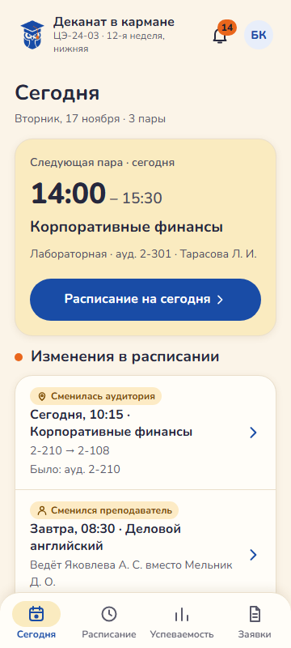
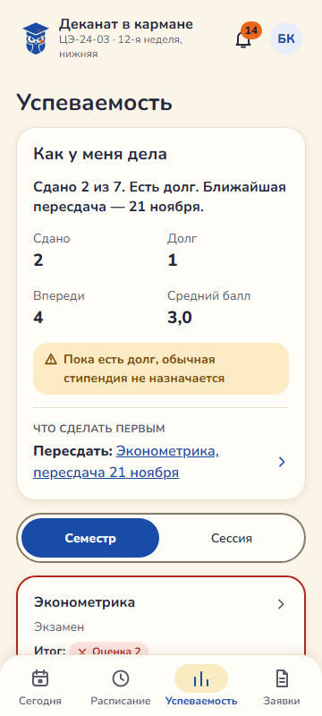
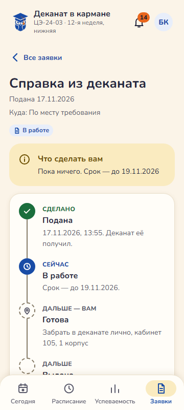

# Деканат в кармане

Концепт личного кабинета студента для конкурса MGIMO AI Challenge, номинация «Вайб-кодинг». Команда — три студента Губкинского университета. Код и документы пишут ИИ-ассистенты; люди ставят задачи, проверяют результат и принимают решения.

> Это концепт для конкурса, а не официальный сервис вуза. В прототипе только вымышленные данные.

## Зачем
Студент открывает кабинет вуза с телефона, чтобы быстро узнать одно: где следующая пара, что поменялось, есть ли долги, готова ли справка. Ответы разбросаны по разным разделам. «Деканат в кармане» собирает их на одном экране «Сегодня» и отвечает обычными словами: «Сдано 2 из 7. Есть долг. Ближайшая пересдача — 21 ноября».

## Попробовать
**Прототип:** https://moy-dekanat.ru — с телефона или с компьютера.

| Кто | Логин | Что посмотреть |
|---|---|---|
| Студент 1 | `belozerov` | Долг и пересдача, нехватка баллов до допуска, готовая справка, переносы пар |
| Студент 2 | `nesterova` | Другая группа и другие данные: отличные оценки, отклонённая заявка |
| Сотрудник деканата | `dekanat` | Заявки студентов: смена статуса, студент видит её сразу |

Пароли — в комментарии к работе. Данные у студентов разные: войдите под обоими — чужого не видно.

## Что посмотреть за пять минут
1. **Студент 1 → «Сегодня».** Следующая пара, изменения в расписании, сроки, заявки и объявления — на одном экране.
2. **«Успеваемость».** Блок «Как у меня дела»: сколько сдано, долг, что сделать первым, сколько баллов не хватает до допуска.
3. **«Заявки» → готовая справка.** Шаги «как у посылки»: что сделано, что сейчас, что дальше и куда прийти.
4. **Заказать справку.** Вид справки, «куда», «Отправить» — и заявка сразу в списке со статусом.
5. **Выйти, войти сотрудником.** Открыть ту же заявку и сменить статус.
6. **Снова студент 1.** Новый статус и уведомление под колокольчиком.
7. **Студент 2.** Те же экраны — другие данные.

| «Сегодня» | «Как у меня дела» | Заявка по шагам |
|---|---|---|
|  |  |  |

Снимки — экран 360 px, прогон проверки на телефоне ворот 3, 17.11.2026.

## Что сделано по заданию
| Требование | Где в прототипе |
|---|---|
| Профиль: ФИО, факультет, направление, курс, группа | Аватар в шапке → «Профиль» |
| Расписание на сегодня и на неделю, аудитория, преподаватель, переносы | «Сегодня», «Расписание»: день, завтра, неделя; верхняя и нижняя недели |
| Оценки и зачёты, сессия, «как у меня дела» | «Успеваемость»: семестр, сессия, карточка дисциплины |
| Справка или заявление и статус | «Заявки»: три вида, пять статусов, шаги с датами |
| Объявления и напоминания о сроках и изменениях | Колокольчик: «Напоминания» и «Новости и объявления» |
| Вход по логину и паролю, данные разделены | Сессия на сервере, пароли только в виде хеша, чужие записи не открываются по адресу |
| Кабинет сотрудника | Вход `dekanat`: список заявок и смена статуса |
| Работа на телефоне | Проверено на 360 и 390 px: [MOB-3.10](docs/reviews/MOB-3.10.md) |

Проверка защиты — [SEC-3.10](docs/reviews/SEC-3.10.md); оценка глазами жюри — [JURY-3.10](docs/reviews/JURY-3.10.md).

## Как шла работа с ИИ
Репозиторий один: продукт и процесс лежат вместе. Всё показанное — настоящее: [правило достоверности](docs/PROCESS.md#достоверность).

Работа шла сменами. В каждой смене основная сессия Claude — оркестратор — читает передачу прошлой смены, раздаёт задания ролям-субагентам и принимает их работу. Код пишет исполнитель, ревью делает другой агент со свежим контекстом, решения принимает человек. Каждая смена оставляет запись в журнале с расходом лимитов. Ошибки ИИ записываются в момент, когда их заметили.

На 17.11.2026 в репозитории:
- 45 записей журнала смен;
- 68 заданий субагентам;
- 42 отчёта ревью и проверок;
- 153 записи об ошибках ИИ — что случилось, как заметили, как исправили;
- 33 слитых PR.

| Что смотреть | Где |
|---|---|
| Как устроена работа с ИИ: роли, ревью, смены, лимиты | [docs/PROCESS.md](docs/PROCESS.md) |
| Правила для ИИ-агента на каждую сессию | [CLAUDE.md](CLAUDE.md) |
| Роли субагентов и команды | `.claude/agents/`, `.claude/skills/` |
| Промпты с привязкой к этапам | [prompts/INDEX.md](prompts/INDEX.md) |
| Задания субагентам и отчёты ревью | `docs/briefs/`, `docs/reviews/` |
| Ошибки ИИ и как их исправили | [docs/evidence/ai-errors.md](docs/evidence/ai-errors.md) |
| Перечень инструментов | [docs/evidence/tools.md](docs/evidence/tools.md) |
| Что сделано вручную | [docs/evidence/manual.md](docs/evidence/manual.md) |
| Журнал работ по сменам, с расходом лимитов | [docs/history/JOURNAL.md](docs/history/JOURNAL.md) |
| Решения и их причины | [docs/DECISIONS.md](docs/DECISIONS.md) |
| Требования задания и чем каждое доказано | [docs/REQUIREMENTS.md](docs/REQUIREMENTS.md) |
| Что узнали у однокурсников | [сводка анкеты](docs/research/survey/summary.md) |

## Карта репозитория
| Где | Что |
|---|---|
| `app/` | Продукт: Next.js, PostgreSQL. Как запустить у себя — [app/README.md](app/README.md) |
| `deploy/` | Скрипты сервера |
| `CLAUDE.md`, `.claude/` | Правила сессии, роли субагентов, команды, настройки |
| `prompts/` | Реестр промптов |
| `docs/ROADMAP.md`, `PROCESS.md`, `DECISIONS.md`, `REQUIREMENTS.md` | План, процесс, решения, требования |
| `docs/risks.md`, `ISSUES.md`, `glossary.md` | Риски, отложенные замечания, термины |
| `docs/HANDOFF.md`, `docs/history/` | Передача смены, журнал работ, утверждённый план |
| `docs/research/`, `briefs/`, `reviews/`, `adr/`, `external/` | Ресерч, задания, отчёты ревью, архитектурные решения, запросы во внешние нейросети |
| `docs/design/`, `docs/data/` | Сценарии, карта экранов, дизайн-система; черновик вымышленных данных |
| `docs/evidence/`, `docs/submission/` | Материалы для описания процесса; чек-лист сдачи |
| `docs/tracker/`, `tools/` | Учёт сроков и инструменты проверки |

## Запуск
- **Продукт** — [app/README.md](app/README.md): Node.js 24, PostgreSQL 18, команды по шагам.
- **Инструменты репозитория** — нужны git и [uv](https://docs.astral.sh/uv/):
  ```
  uv run tools/check_all.py        # все проверки
  uv run tools/tracker.py due      # сроки: что просрочено, что сегодня и завтра
  ```

## Права и сторонние материалы
По Регламенту конкурса права на материалы работы переходят организатору при отправке. Поэтому открытой лицензии на свой код здесь нет. Сторонние библиотеки и материалы и их лицензии — [THIRD_PARTY.md](THIRD_PARTY.md).
